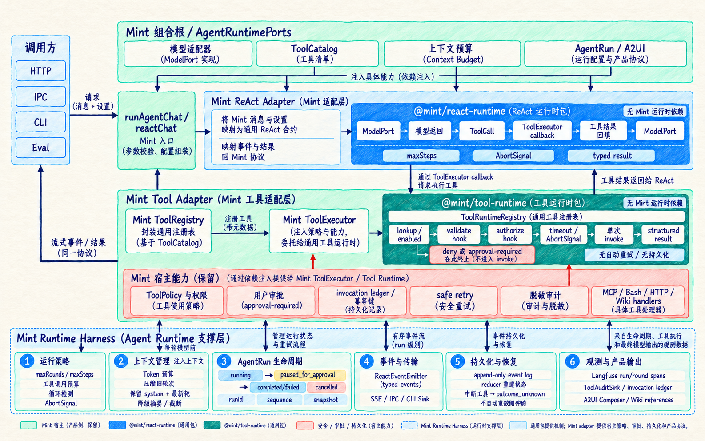
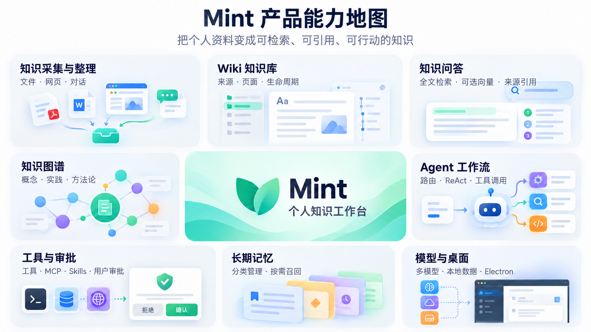
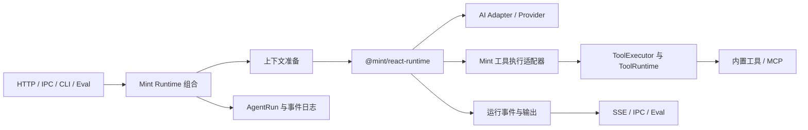

# Mint

[](LICENSE)
[](https://www.electronjs.org/)
[](https://nodejs.org/)
[](https://react.dev/)
[](https://www.typescriptlang.org/)
[](https://vitejs.dev/)
[](https://github.com/dingw530/mint-ai-chat)

[功能介绍与演示](https://dingw530.github.io/mint-llm-wiki)

## 1. Mint 是什么？

Mint 是一款以个人知识工作台为核心的 AI 助手，也是一款 Electron 桌面应用。它将文档、网页和对话整理为可检索、可持续维护的 Wiki，并通过知识问答、Agent 和工具调用帮助用户使用这些知识。

会话、设置、Wiki 和 SQLite 向量索引默认保存在本机。模型和 Embedding 请求使用用户配置的 API；向量索引也可以配置为使用 Chroma。

## 2. 为什么选择 Mint？

- **把资料变成可维护的知识。** 原始来源、编译后的 Wiki 页面和索引状态都能在一个工作台中管理。
- **回答可以回到来源。** Wiki 搜索会返回页面、章节和证据标识，Agent 可在回答中引用检索到的内容。
- **工具调用经过统一治理。** 工具执行会经过注册、输入校验、权限策略、审批、超时和审计等应用层控制。
- **运行中断后可以检查和恢复。** Mint 持久化关键 AgentRun 事件，重建中断状态，并让用户选择恢复动作。
- **数据和模型接入可配置。** 应用数据默认存于本机；模型、Embedding 和可选的向量服务由用户配置。

## 3. 架构

Mint 分为 React 客户端、服务端应用和两个可移植 runtime 包。服务端组合具体的模型、工具、数据库、传输和观测能力；可移植包不依赖 Mint 服务端。

<p align="center">
  
</p>

主要技术包括 Electron、React 18、Vite 5、TypeScript 6、Express 4、Vercel AI SDK、better-sqlite3、SQLite FTS、sqlite-vec 和 Model Context Protocol SDK。评测与测试使用独立的 `agent-eval` 工作区和 Vitest。

## 4. Agent Runtime

Mint 的服务端 Agent Runtime 将 ReAct 执行、模型接入、工具治理、运行事件和传输连接起来。可移植循环位于 `packages/react-runtime`；Mint 的实现和宿主适配器位于 `apps/server/`。

### 最小 ReAct 核心

`@mint/react-runtime` 提供一个有步数上限的 ReAct 循环。宿主传入模型端口、工具执行端口和工具定义。核心负责调用模型、执行模型返回的工具调用、累积消息与 usage，并通过事件回调报告运行进度。

该包面向 Node.js 20 或更新版本，不依赖模型 SDK、Web 框架、数据库或 Mint 服务端。它不内置 Plan-and-Execute 调度器，也不负责审批、持久化或重试策略。

### Ports & Adapters

模型与工具执行是 ReAct 核心的外部端口。Mint 在 `mint-react-adapter.ts` 中映射自己的消息和工具类型；服务端组合 AI SDK provider、工具目录、上下文管理、工具执行器、AgentRun 和输出事件。

宿主继续负责 provider 配置、工具权限、审批、持久化、重试和 SSE/IPC 传输。这样可移植包保持较小，Mint 也能复用现有应用策略。

## 5. Tool Runtime

`@mint/tool-runtime` 提供工具注册表和单次执行流程。它不依赖 Mint、Zod、模型 SDK、数据库或 HTTP 框架；宿主通过回调提供工具启用状态、输入校验、授权和实际执行。

### 受治理的工具执行

调用先经过工具查找、启用状态检查、输入校验和授权。授权结果可以是允许、拒绝或需要审批。执行阶段支持取消和超时，并返回结构化结果。

该包只负责单次执行尝试。Mint 应用层负责调用重试、审批恢复、幂等记录、持久化和审计。Agent 工具调用经过统一的应用级 `ToolExecutor`，MCP 工具也通过服务端工具目录和适配器进入此路径。

## 6. 可恢复的 Agent Runs

AgentRun 表示一次 Agent 执行。它管理运行阶段、事件顺序、工具调用状态、审批暂停和订阅者；SQLite 事件日志为进程重启后的诊断与恢复提供依据。

### AgentRun 生命周期

运行状态包括执行中、等待审批、已完成、失败和已取消。运行事件带有 `runId` 与递增序号。终态事件写入后，AgentRun 不再接受新事件。

### 持久化事件

Mint 将一组精简、非敏感的生命周期事件追加到 SQLite，包括运行开始、轮次开始、工具开始与结束、审批需求和运行终态。事件包含 schema 版本，并由仓储检查序号、重复写入和终态约束。

### 状态重建

纯函数 Reducer 按事件顺序还原运行快照，包括阶段、轮次、工具调用和审批状态。重建过程不会调用模型或工具，也不会修改数据库；发现缺失、乱序或不支持的事件版本时会报错。

### 未知工具结果

如果进程在工具调用完成前中断，Mint 将结果标记为 `tool_outcome_unknown`。这表示工具可能已经产生副作用，系统不会自动重放该调用。用户可以查看可用动作；对未知结果执行重试时需要确认。恢复动作会创建后续运行，并使用幂等键记录。

## 7. 上下文工程

Mint 在每次模型调用前估算消息 token，并按预算准备上下文。默认上下文预算为 100,000 tokens，并预留 4,096 tokens 给模型输出。超过预算阈值时，系统尝试摘要较早的对话单元；摘要失败时使用确定性摘要，再按完整对话单元裁剪。System 消息和最新对话优先保留，工具结果不会与对应调用分开裁剪。

较大的工具结果会保存为本地 context artifact，并在上下文中保留预览和读取路径。Agent 可以通过 `read_artifact` 分页读取文件；读取范围限制在 Mint 的 artifact 目录。Artifact 有闲置和最长保留时间，并在存储接近容量上限时清理。

长期记忆按类别和作用域管理。运行上下文按核心记忆与检索记忆分别选择，再按 token 预算打包；记忆检索使用本地全文索引与确定性相关性筛选。

## 8. RAG、知识与记忆

Wiki 原始来源和知识页面以本地 Markdown 文件保存。SQLite 保存应用数据、页面生命周期和搜索索引；向量索引默认使用 sqlite-vec，也可配置 Chroma。Embedding 使用 OpenAI-compatible API。

### 混合检索

Wiki 默认使用全文检索。启用混合模式后，系统将全文检索与向量检索候选合并，再以 Reciprocal Rank Fusion（RRF）排序。向量服务不可用时，检索会回退到关键词模式。

### 重排

Jev 语义重排是可选功能，默认关闭。启用后，它会对选定候选进行语义评分；调用失败时回退到原有排序。

### 来源追溯

Wiki 搜索结果包含页面、章节和 `chunkId` 等来源信息。Agent 工具会为本轮证据分配引用标识；回答引用需要对应实际检索结果。`agent-eval` 分别记录最终答案引用和检索证据，便于检查答案引用覆盖、准确性、证据对应关系和检索覆盖率。

长期记忆与 Wiki 检索是不同能力：记忆用于保存和召回用户事实，Wiki 用于检索来源文档和知识页面。

## 9. 评测

`apps/agent-eval/` 提供 Wiki-RAG 数据集、语料准备与摄入、Live Agent 运行、Judge、结果版本和报告查看器。查看[评测工具 README](apps/agent-eval/README.md)了解完整参数。

评测同时检查答案、工具预算、无答案拒答、引用身份、证据覆盖和运行终态等条件。报告区分单次通过率、Pass@k（至少一次通过）和 Pass^k（多次全部通过），并提供引用与检索指标、延迟统计和版本比较。LLM Judge 可用于答案与证据评分，但不会覆盖确定性安全或证据门禁结果。

评测运行支持 checkpoint 和恢复。使用真实模型或 Judge 时，结果会受 provider、模型、配置和数据集版本影响；请保留报告中的运行来源信息，并将本地评测结果与生产质量结论区分开。

## 10. 产品能力

<p align="center">
  
</p>

知识问答默认使用全文检索；向量检索可选启用。Jev 语义重排也为可选功能。

## 11. 仓库结构

```text
apps/
  client/       React SPA 与 UI
  server/       Express API、Agent Runtime、工具和 SQLite 服务
  electron/     Electron 主进程、preload、IPC 与桌面打包
  agent-eval/   Wiki-RAG 评测 CLI、数据集与报告查看器
  website/      GitHub Pages 网站

packages/
  react-runtime/  可移植的最小 ReAct 循环
  tool-runtime/   可移植的工具注册和单次执行

docs/
  changes/       按变更维护的产品规格、设计和执行记录
  architecture/  架构图
  diagrams/      产品与技术架构图
```

## 12. Runtime 组合

`apps/server/bootstrap/agent-runtime.ts` 组合 provider、工具目录、工具执行、上下文准备、AgentRun 和观测端口。`react-loop-core.ts` 使用这些端口运行 ReAct，并将模型输出、工具结果和生命周期事件交给宿主 sink。



## 13. Web 与 Electron 集成

**Web 模式**：React 客户端由 Vite 提供开发服务，Express 提供 API 与 SSE。前端通过 `/api` 代理访问服务端。

**Electron 模式**：主进程加载服务端 bundle，并在进程内启动 Express；preload 通过 `contextBridge` 暴露 IPC 接口。桌面客户端的注册端点和对话流通过 IPC 调用主进程服务，生产环境的 Express 同时提供客户端静态资源和 HTTP API。

Docker Compose 默认只将服务发布到本机 `localhost:3001`。Mint HTTP API 没有用户认证；不要通过局域网、反向代理或自定义端口映射公开服务。CORS 不提供访问控制。

## 14. 可观测性

Mint 使用结构化日志记录运行和工具执行信息。启用并配置 Langfuse 后，AgentRun 和模型轮次会关联 OpenTelemetry trace；关闭 Langfuse 时，核心运行不依赖追踪服务。

工具审计记录工具来源、风险等级、运行与调用标识、结果状态、错误码、重试次数和参数摘要。模型输入与输出是否发送到 Langfuse 由 `MINT_LANGFUSE_CAPTURE_CONTENT` 控制；生产环境默认不采集内容。

## 15. 快速开始

### 环境要求

- Node.js `20.19.4`
- npm

Server、Vitest 和构建脚本会校验并使用指定 Node 版本。可以使用 nvm 安装：

```bash
nvm install 20.19.4
nvm use
npm install
```

### Web 开发

Web 模式需要 `AI_CHAT_ENCRYPTION_KEY`，用于加密 API 密钥等敏感数据：

```bash
export AI_CHAT_ENCRYPTION_KEY="$(openssl rand -hex 16)"
npm run dev
```

默认地址：前端 <http://localhost:5800>，API <http://localhost:3001>。密钥也可以保存在 `apps/server/.env`。Server 默认端口被占用时会回退到随机端口，以启动日志中的端口为准。

### Docker

```bash
AI_CHAT_ENCRYPTION_KEY="$(openssl rand -hex 16)" docker compose up --build
```

Compose 默认仅发布到本机。访问边界说明见[Web 与 Electron 集成](#13-web-与-electron-集成)。

### Electron 开发与打包

```bash
npm run electron:dev:server
npm run electron:build:mac
```

Electron 首次启动会在 `~/.mint/.env` 生成并保存加密密钥。macOS 安装包位于 `apps/electron/release/`。打包或原生依赖变更后，可运行 `npm run verify:electron-artifact:mac` 检查构建产物。

更多源码验证命令见项目 [AGENTS.md](AGENTS.md) 和 [.harness/README.md](.harness/README.md)。

## 16. 架构决策

- **将通用机制放在可移植包中。** ReAct 循环和通用工具执行机制不依赖 Mint 的数据库、传输或 provider SDK。
- **将策略留在宿主应用。** provider、授权、审批、重试、审计、持久化和传输由 Mint 服务端组合。
- **副作用工具统一经过执行门。** 目录、校验、授权和工具调用集中在应用工具执行路径中。
- **不自动重放结果未知的工具调用。** 进程中断后先恢复状态，由用户选择后续动作。
- **本地数据作为默认存储。** SQLite 管理应用数据和索引；Chroma 与外部 AI API 需要用户配置。
- **按变更记录产品工作。** 产品功能规格、设计、执行计划和追溯记录放在 `docs/changes/`；具体验证范围以对应变更记录为准。

## 17. 状态与路线图

当前代码已包含桌面与 Web 运行路径、可移植 ReAct 和 Tool Runtime、AgentRun 恢复、Wiki 检索、长期记忆及独立评测工具。各能力的实际边界以代码和对应验证证据为准。

项目没有单独维护一份承诺交付日期的公开路线图。正在执行或计划中的产品变更以 [`docs/changes/`](docs/changes/) 中的变更记录和状态为准；规格、设计与执行索引见 [`docs/product-specs/`](docs/product-specs/README.md)、[`docs/design-docs/`](docs/design-docs/README.md) 和 [`docs/exec-plans/`](docs/exec-plans/README.md)。

## 18. 许可证

Mint 使用 [MIT 许可证](LICENSE)。
