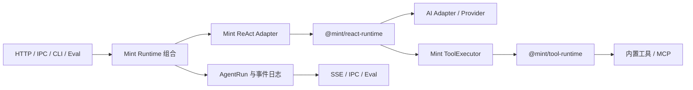

# Mint

[](LICENSE)
[](https://www.electronjs.org/)
[](https://nodejs.org/)
[](https://github.com/dingw530/mint-ai-chat)

**Mint 是一款个人知识工作台：把资料编译成可追溯的 Wiki，再由 Agent 在受治理、可恢复的 Runtime 中使用知识和工具。**

[功能介绍与演示](https://dingw530.github.io/mint-llm-wiki)

## 1. Mint 是什么？

Mint 将文档、网页和对话整理为本地 Wiki，提供知识检索、来源引用、Agent 工具调用和长期记忆。它以 Electron 提供桌面应用，也支持通过 Web 运行。

应用数据默认保存在本机。模型、Embedding 和可选的 Chroma 向量服务使用用户配置的端点。

## 2. 为什么这样设计？

- **Agent Loop 容易膨胀。** 模型调用、工具、上下文和产品逻辑增长后，循环难以独立复用和验证。
- **工具治理容易散落。** 工具增多后，输入校验、授权、审批和副作用控制需要统一入口。
- **长任务不等于一次 HTTP 请求。** 工具调用、人工审批和进程中断要求运行状态可查询、可恢复。
- **RAG 不止是检索。** 知识链路还需要来源追溯、引用校验和可重复评测。

后续章节分别介绍这些边界：ReAct 核心、工具运行、AgentRun 恢复，以及 Wiki 检索与评测。

## 3. 架构总览

Mint 由 React 客户端、服务端应用和两个可移植 Runtime 包组成。服务端组合模型、工具、上下文、持久化和传输适配器；通用执行核心不依赖 Mint 服务端。

<p align="center">
  
</p>

主要技术：Electron、React、Vite、TypeScript、Express、Vercel AI SDK、SQLite、sqlite-vec、Model Context Protocol SDK 和 OpenTelemetry。

## 4. Agent Runtime

Mint 在服务端组合模型适配器、上下文准备、工具目录、AgentRun 和事件传输。ReAct 循环通过明确的端口调用模型和工具。

### 最小 ReAct 核心

`@mint/react-runtime` 提供带步数上限的 ReAct 循环。宿主传入模型端口、工具执行端口和工具定义；核心负责模型与工具往返、结果组织和运行事件。

该包面向 Node.js 20 或更新版本，不依赖模型 SDK、Web 框架、数据库或 Mint 服务端。审批、持久化、重试和传输由宿主负责。

### Ports & Adapters

Mint adapter 将应用消息和工具类型映射到通用 ReAct 合约，再把结果和事件映射回 Mint。AI SDK providers、上下文窗口、AgentRun 和工具策略都留在服务端组合层。

更详细的边界见 [Agent Runtime 架构图](docs/architecture/mint-agent-runtime-v3.png)。

## 5. Tool Runtime

`@mint/tool-runtime` 提供工具注册、检查和一次执行。调用经过查找、启用状态、输入校验、授权或审批、取消与超时处理，再返回结构化结果。

它不负责重试、幂等记录、持久化和审计。这些策略由 Mint 宿主的 `ToolExecutor` 与应用服务统一承担。

## 6. Durable Agent Runs 与故障恢复

AgentRun 为一次执行提供生命周期、事件顺序、审批暂停和订阅边界。SQLite 保存精简的运行事件，用于中断后的诊断和状态重建。

### 生命周期与持久化事件

事件记录运行开始、轮次、工具调用开始与结束、审批需求和终态，并包含递增序号与 schema 版本。

### Reducer 状态重建

纯函数 Reducer 按事件顺序恢复运行阶段、轮次、工具状态和审批信息。重建过程不会调用模型或工具，也不会写数据库；无效或不连续的事件会报错。

### `tool_outcome_unknown`

如果进程在工具调用完成前中断，Mint 将结果标记为 `tool_outcome_unknown`。工具可能已经产生副作用，所以系统不自动重放。用户可以选择恢复动作；重试未知结果需要确认，恢复操作用幂等键记录。

## 7. Context Management

每轮模型调用前，Mint 按 token budget 准备上下文：低于阈值时保留原消息；超出阈值时压缩较早对话，并优先保留 system 消息和最新完整对话单元。大工具结果保存为本地 artifact，上下文只保留预览和读取路径。

长期记忆按类别与作用域召回，并使用独立预算打包。详见[上下文管理设计](docs/architecture/context-management.md)。

## 8. RAG、知识与记忆

Wiki 的原始来源和知识页面以 Markdown 保存。SQLite 管理应用数据与全文索引；向量索引默认使用 sqlite-vec，也可配置 Chroma。Embedding 使用 OpenAI-compatible API。

### 混合检索与重排

全文检索默认开启。配置混合模式后，系统合并全文与向量召回结果，并以 RRF 排序。Jev 语义重排为可选功能，调用失败时回退到原有排序。

### 来源追溯

搜索结果携带页面、章节和 chunk 标识。Agent 工具为本轮证据分配引用标识，回答引用必须对应实际检索结果。长期记忆保存并召回用户事实，与 Wiki 文档检索分开处理。

## 9. 评测

`apps/agent-eval/` 提供固定 Wiki-RAG 数据集、隔离语料摄入、重复运行、deterministic gates、Judge 和报告版本。评测分别报告答案、工具预算、拒答、引用和检索指标；Pass@k 与 Pass^k 分开计算。

最近保存的报告快照：Wiki-RAG 1.2.1，25 道问题各运行 3 次，共 75 次运行。

| 指标                         |                            结果 |
| ---------------------------- | ------------------------------: |
| Pass@1                       |                             96% |
| Pass@3（至少一次通过）       |                             96% |
| Pass^3（三次全部通过）       |                             96% |
| 引用覆盖、准确与检索证据对应 |                         各 100% |
| 检索覆盖率                   |                            100% |
| Recall@5                     | 100%（63 次符合统计条件的运行） |
| LLM Judge Pass@1             |       83.3%（72 次 Judge 运行） |

报告生成于 2026-10-04，对应 `develop@41615ff` 的脏工作树快照，不是当前分支的重跑结果。查看[完整报告](apps/agent-eval/viewer/versions/20261004-k3-jev-configured.json)和[评测说明](apps/agent-eval/README.md)。这些指标描述该数据集与该次配置，不代表生产环境准确率。

## 10. 产品能力

<p align="center">
  
</p>

## 11. 仓库结构

```text
apps/
  client/       React SPA 与 UI
  server/       Express API、Agent Runtime、工具和 SQLite 服务
  electron/     Electron 主进程、preload、IPC 与桌面打包
  agent-eval/   Wiki-RAG 评测 CLI、数据集与报告查看器
  website/      GitHub Pages 网站

packages/
  react-runtime/  可移植的最小 ReAct 循环
  tool-runtime/   可移植的工具注册和单次执行

docs/
  changes/       产品规格、设计和执行记录
  architecture/  Runtime、上下文及服务端架构说明
  diagrams/      产品与技术架构图
```

## 12. Runtime 组合

`apps/server/bootstrap/agent-runtime.ts` 组合具体端口。`react-loop-core.ts` 通过 Mint adapter 调用可移植 ReAct 核心；工具调用进入宿主执行门，生命周期事件由 AgentRun 传给 SSE、IPC 或评测运行器。



## 13. Web 与 Electron

- **Web**：React 客户端通过 `/api` 访问 Express；对话响应使用 SSE。
- **Electron**：主进程加载服务端 bundle 并启动 Express；preload 通过 `contextBridge` 暴露 IPC。桌面端对话流和注册端点通过 IPC 调用主进程服务。

Docker Compose 默认只发布到 `localhost:3001`。HTTP API 没有用户认证，不要通过局域网或反向代理公开服务；CORS 不提供访问控制。

## 14. 可观测性

Mint 使用结构化日志和工具审计。配置 Langfuse 后，AgentRun 与模型轮次关联 OpenTelemetry trace；生产环境默认不采集模型输入与输出。

## 15. 快速开始

需要 Node.js `20.19.4` 和 npm。

```bash
nvm install 20.19.4
nvm use
npm install
export AI_CHAT_ENCRYPTION_KEY="$(openssl rand -hex 16)"
npm run dev
```

默认访问前端 <http://localhost:5800>，API <http://localhost:3001>。Electron 开发与构建命令见 [`package.json`](package.json)；开发文档见 [.harness/README.md](.harness/README.md)。

## 16. 架构文档与决策记录

- [技术架构总览](docs/diagrams/architecture.svg)
- [Agent Runtime 结构图](docs/architecture/mint-agent-runtime-v3.png)
- [上下文管理](docs/architecture/context-management.md)
- [服务端分层与依赖方向](docs/architecture/LAYERS.md)
- [产品规格、设计和执行计划索引](docs/product-specs/README.md)、[设计文档](docs/design-docs/README.md)、[执行计划](docs/exec-plans/README.md)

架构决策目前记录在 `docs/architecture/` 和各变更的 `design-doc.md` 中，尚未单独维护 ADR 目录。

## 17. 许可证

Mint 使用 [MIT 许可证](LICENSE)。
