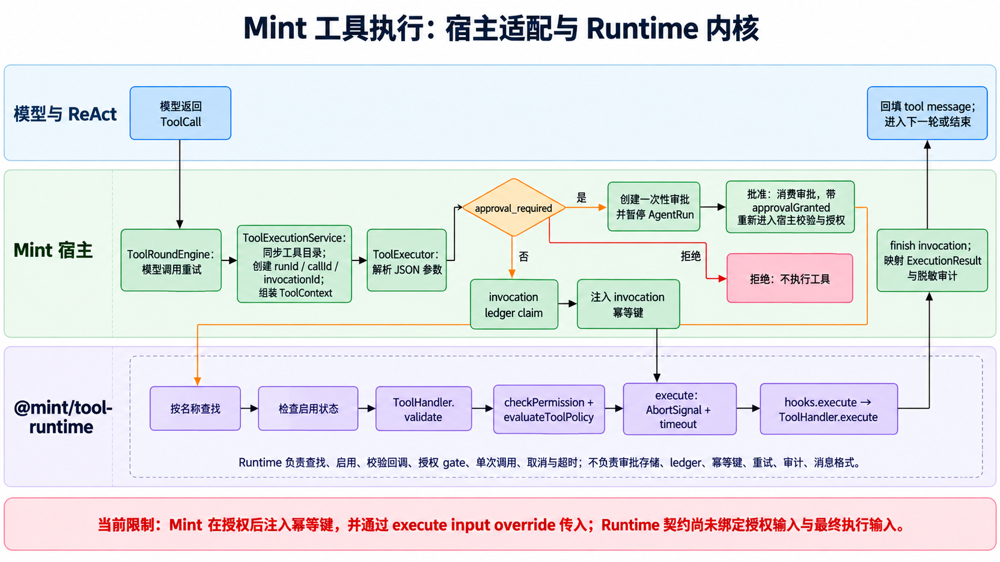

# 设计文档：可移植的最小 ReAct 框架包

## 背景与目标

在 Mint 代码库中形成两条清晰的通用内核边界：ReAct Runtime 管理轮次；Tool Runtime 管理工具目录和一次工具执行。模型供应商、权限、审批、重试、持久化、审计和传输由宿主提供。Mint 适配层连接现有 `AgentRuntimePorts`、ToolExecutionService 和产品事件，保持既有行为。

## 约束

- 新包独立构建，运行时代码无 Mint 相对导入，无模型供应商 SDK 依赖。
- 框架只支持 ReAct，不抽象多策略执行器。
- 工具实际执行继续由 Mint ToolExecutionService/ToolExecutor 完成，审批与调用审计保持在现有可信路径。
- Tool Runtime 只提供通用执行机制；调用策略、调用 ledger、safe retry 和 audit sink 由 Mint adapter 提供。
- 现有 `runAgentChat` 调用签名和 transport events 尽量保持不变。
- 不修改 `.claude/skills/`、`.harness/`、用户已有无关改动和其他变更目录。

## 方案与决策

### 包位置

在仓库根维护两个 npm workspace：`packages/react-runtime`（`@mint/react-runtime`）和 `packages/tool-runtime`（`@mint/tool-runtime`）。各自通过 `package.json`、`tsconfig.json` 和 `src/index.ts` 独立构建，输出 ESM JavaScript 和 `.d.ts`，并可通过 npm tarball 安装。Server 显式依赖两个 workspace 包。

### 责任边界

```text
宿主项目
  ├─ ModelPort：一次模型生成/流式 delta 与完整 tool calls
  ├─ Tool：定义、JSON Schema、执行函数
  ├─ 可选事件监听与 AbortSignal
  └─ ReActAgent.run()
       └─ @mint/react-runtime：消息循环、步数边界、工具结果回填、事件

Mint Adapter
  ├─ AiAdapter → ModelPort
  ├─ ToolCatalogService → Tool 定义
  ├─ ToolExecutionService/ToolExecutor → Tool 执行
  └─ ReactEvent/AgentRun/Sink/A2UI/上下文/审批 → Mint 产品能力
```

框架 API 采用 `createReactAgent({ model, tools, policy })` 和 `agent.run({ messages, context, signal, onEvent })`。定义中不出现 `AiSettings`、`HistoryMessage`、`StreamResult`、`AgentRun`、`Sink` 或 A2UI 类型。

### Tool Runtime 核心与 Mint adapter

#### DS-006：独立 Tool Runtime 包

#### DS-006：独立 Tool Runtime 包

`@mint/tool-runtime` 提供通用 `ToolRuntimeRegistry` 与 `ToolRuntime<Tool, Context>`：

- Registry 只管理按工具名索引的通用 Tool handler；支持注册、查找、枚举和显式替换，不写日志、不认识类别或 MCP。
- Runtime 通过必需的宿主 callbacks 检查 enabled、validate、authorize 和 invoke；它不依赖 Zod、MCP 或 Mint 的 `ToolContext`。
- `prepare()` 返回 `ready`、结构化拒绝或 `approval_required`；`execute()` 只接受 `ready` preparation，统一处理 AbortSignal、timeout、工具异常和结果状态。
- 宿主策略回调返回 `allow`、`deny` 或 `approval_required`。未 `allow` 时，Runtime 不进入工具执行函数。
- Runtime 只运行单次 attempt；不自动重试、不声明副作用幂等、不持久化。Mint adapter 根据 retrySafety、invocation ledger 和 result-unknown 语义控制安全重试。
- Runtime 返回工具标识、状态、耗时和错误类别；参数值、日志脱敏和审计由宿主处理。

Mint adapter 将现有 `ToolHandler` 投影到通用工具接口。`BaseTool` 继续生成 Mint/OpenAI 工具定义并实施 Zod/JSON Schema 校验；Mint `ToolExecutor` 提供本地权限检查、`evaluateToolPolicy`、审批回调、调用 claim/finish、幂等键、safe retry 和审计。`ToolExecutionService` 继续持有 invocation repository、审批存储和 audit sink，并作为生产单一执行入口。

现有 `ToolRegistry` 保留分类查询、OpenAI schema 输出、工具摘要和日志；目录存储/注册机制复用 `@mint/tool-runtime` 的通用 registry。生产 API 仍由 ToolExecutionService 返回原有 ExecutionResult，避免把框架结果类型暴露给 SSE 或前端。

#### DS-007：Mint adapter 与工具安全所有权

```text
ToolExecutionService：runId/callId、approval store、invocation ledger、audit sink
  → Mint ToolExecutor：BaseTool validation、checkPermission、evaluateToolPolicy、idempotency key、retrySafety
  → @mint/tool-runtime：registry lookup、enabled/validate hooks、authorize gate、timeout/AbortSignal、one attempt
  → Mint ToolExecutor：ExecutionResult、outcome_unknown、重试、脱敏 audit 映射
  → ToolRoundEngine：维持既有模型 ToolCall 重试与工具消息格式
```

Generic runtime 的单次执行是生产 ToolExecutor 的内部依赖，不能作为新的 handler 调用入口。MCP、Bash、HTTP、Wiki 和 Knowledge Graph tool handlers 均留在 Mint。远端 `readOnlyHint` 不参与授权；approval、invocation state 和 audit 决策仍由 Mint adapter 提供。

#### Tool Runtime 单次调用流程与宿主适配



```text
模型返回 ToolCall
  → ToolRoundEngine.executeToolCallWithRetry()
      → ToolExecutionService.executeToolDetailed()
          → 同步工具目录；确定 runId、callId、invocationId
          → 建立 ToolContext：调用状态、审计、取消信号、审批回调
          → ToolExecutor.executeFromToolCall()
              → 解析 JSON arguments
              → ToolExecutor.prepareExecution()
                  → ToolRuntime.prepare(name, input, context)
                      → 按名称查找工具
                      → 检查工具启用状态
                      → ToolHandler.validate 校验输入
                      → checkPermission + evaluateToolPolicy 授权
                  → 非 ready：返回失败、取消或待审批结果；不 claim、不执行工具
              → ToolExecutor.claimInvocation()
                  → invocation ledger 记录工具名、输入 hash、retrySafety
              → ToolExecutor.runTool()
                  → 注入 invocation idempotency key
                  → ToolRuntime.execute(ready, { input, context, signal, timeoutMs })
                      → 组合 AbortSignal 与 timeout
                      → 调用 hooks.execute
                      → ToolHandler.execute(input, { ...ToolContext, signal })
                  → 更新 invocation 状态；根据 retrySafety 决定是否重试
                  → 转换为 Mint ExecutionResult，并发出脱敏审计事件
          → 按结果决定模型调用重试，并生成 assistant/tool 消息
      → ReAct 后续轮次或结束
```

`@mint/tool-runtime` 负责通用工具查找、启用检查、输入校验回调、授权 gate、单次调用、取消和超时。它不创建调用身份，也不负责审批存储、invocation ledger、幂等键、重试策略、日志脱敏、审计 sink 或模型消息格式。Mint 的 `ToolRegistry` 继承通用 registry，并增加类别、OpenAI 工具定义和调用/结果摘要；`ToolExecutionService` 是应用层统一入口，创建调用身份并组装宿主上下文；`ToolExecutor` 把 `ToolHandler` 与 Mint 的权限策略、审计及结果类型适配到通用接口。

Mint 有两层重试控制，职责不同：`ToolExecutor.runTool()` 只对可重试异常且 `retrySafety` 允许的 handler attempt 重试；`ToolRoundEngine.executeToolCallWithRetry()` 根据 `ExecutionResult.retryable` 和模型侧配置再次提交同一个 ToolCall。`@mint/tool-runtime.execute()` 本身始终只执行一次，不重试。

审批不是 runtime 内部的等待状态。策略返回 `approval_required` 后，Mint 通过 `ToolContext.requestApproval` 创建一次性审批，并暂停关联的 AgentRun。用户批准后，`ToolApprovalService` 消费审批，再调用 `ToolRoundEngine.executeToolCallWithRetry()` 恢复原调用，传入 `approvalGranted`；流程会重新经过 `ToolExecutionService`、参数校验和权限/策略检查。用户拒绝时不调用工具。

**实现边界：** 当前 `ToolRuntime.prepare()` 返回可变 `ready` 对象，且 `execute()` 允许用 options 替换 input/context。Mint 在授权和 invocation claim 之后向 input 注入幂等键，再用 `execute()` 的 input override 传入最终 handler。因此，当前公开契约没有保证授权输入与最终执行输入绑定一致。该问题是现状限制；修复方向是让执行只消费 preparation 中绑定的值，或对最终值重新校验并授权。文档不将其描述为已解决。

#### 当前实现源码

- 通用运行时与 registry：[`packages/tool-runtime/src/tool-runtime.ts`](../../../packages/tool-runtime/src/tool-runtime.ts)、[`packages/tool-runtime/src/tool-registry.ts`](../../../packages/tool-runtime/src/tool-registry.ts)。
- Mint registry 扩展：[`apps/server/application/agent-runtime/tooling/tool-registry.ts`](../../../apps/server/application/agent-runtime/tooling/tool-registry.ts)。
- ToolHandler 适配、授权、invocation claim、重试与结果映射：[`apps/server/application/agent-runtime/tooling/tool-executor.ts`](../../../apps/server/application/agent-runtime/tooling/tool-executor.ts)。
- runId/callId、审批与审计上下文、统一应用入口：[`apps/server/application/agent-runtime/tool-execution-service.ts`](../../../apps/server/application/agent-runtime/tool-execution-service.ts)。
- 模型 ToolCall 重试与消息格式：[`apps/server/application/agent-runtime/tool-round-engine.ts`](../../../apps/server/application/agent-runtime/tool-round-engine.ts)。
- 审批消费与恢复：[`apps/server/application/agent-runtime/tool-approval-service.ts`](../../../apps/server/application/agent-runtime/tool-approval-service.ts)。

#### DS-007：保留 Mint 安全与副作用治理

```text
Model ToolCall
  → ToolExecutionService：稳定 runId/callId、invocation claim、审计上下文
  → Mint ToolExecutor adapter：BaseTool validate、permission、ToolPolicy、审批、retrySafety
  → @mint/tool-runtime：registry lookup、执行 gate、AbortSignal/timeout、单次 invoke、基础结果
  → Mint ToolExecutor：invocation finish、结构化脱敏审计、Mint error/result 映射
  → ToolRoundEngine：按 Mint retrySafety 决定是否重新调用
```

通用包不得看到完整 `ToolContext` 或根据 MCP `readOnlyHint` 推导权限。Mint 的安全决策在宿主 gate 中完成；只有 gate 明确 allow 后，包才能调用工具实现。结果为 approval-required、unknown 或 failed 时，既有 Mint 语义优先，不得把它们折叠成 success。

### ReAct 核心

- `ModelPort.generate()` 输入通用消息与工具 schema，返回 assistant 内容、零到多个有序工具调用及可选 usage。模型 delta 通过可选回调转成框架事件。
- `Tool` 包含 `name`、`description`、JSON Schema 和 `execute(input, context)`。框架按模型工具调用的原顺序查找并执行；宿主负责在执行函数里校验权限和参数。
- 每个工具结果作为含 `toolCallId` 的 tool message 追加到轨迹，随后进入下一模型轮次。
- 模型不再请求工具时正常完成；达到 `maxSteps` 后以 `step_limit` 终止；取消和失败使用明确事件/错误。
- 工具失败映射为结构化失败结果或明确失败事件，避免当作成功内容写入轨迹。是否允许模型继续由一个简单固定的 fail-fast/return-error 策略决定，优先与 Mint 现有 ToolRoundResult 语义对齐。

### Mint 适配

保留 `bootstrap/agent-runtime.ts` 作为 Mint composition root，创建 adapter 并提供现有端口。`reactChat` 保留兼容签名，内部由适配层运行框架；适配器将框架模型调用委托到现有 `executeRound`，工具执行委托到 `executeToolCallWithRetry`，事件映射到 `ReactEventEmitter`。如果提取完整的流式模型端口会破坏现有审批或 token 事件语义，可先使用框架的 model-turn callback 包住现有单轮执行，但循环、工具结果拼接和 stop policy 必须由通用框架控制。

框架不得直接订阅 SSE 或创建 `AgentRun`。Mint adapter 负责终态、审批暂停、上下文压缩、A2UI Composer、Wiki 引用和 usage 汇总。

### 构建与消费

- 根 `workspaces` 加入 `packages/react-runtime` 与 `packages/tool-runtime`。
- `server/package.json` 依赖两个包，构建/测试/类型检查前确保 workspace package 有 dist 声明与 JS；开发依赖安装后通过 node_modules workspace link 消费。
- 包 `exports` 明确 ESM `import` 与 `types`，`files` 只发布 `dist` 和 README。
- README 含无 API Key 的假模型和工具示例，以及 Node 20 使用要求。

## 影响与风险

- 首要风险为 `reactChat` 的广调用面，以及审批恢复路径中的同一 `AgentRun` 连续性。
- ToolExecutor 与 ToolExecutionService 处在生产工具调用的安全闸口；新 runtime 必须从当前单一入口调用，不能新增绕过 approval、invocation ledger 或审计的 handler 通道。
- 包边界的验收同时检查 TypeScript/JS 可导入、npm pack 清单、核心无外部 Mint import。
- Mint adapter 的既有事件必须保持唯一 terminal event、工具执行顺序和 call ID 关联。
- 如果框架控制流接入需要改变已有事件协议或将审批/持久化迁入框架，应暂停并记录偏差，不扩大本次范围。

## 发布验证

- package-only build、node import smoke、npm pack 和安装 tarball 的独立 Node 项目 import smoke。
- Tool Runtime 单测和独立 tarball smoke：覆盖 duplicate/unknown/disabled tool、validation、deny/approval、timeout、abort 和 thrown error；确认拒绝时 execute count 为 0。
- 假模型多轮 ReAct integration：工具调用、call ID 回填、终答、step limit、取消、未知工具和工具错误。
- Mint adapter 定向测试：历史调用、流式 answer、工具审批暂停与续跑、AgentRun 终态、A2UI/Wiki 输出、usage。
- server typecheck/build、受影响的 ReAct/approval/subagent/eval 测试及 Harness。
- 不做浏览器验收：本变更不修改 UI；Harness 中明确 browser 场景不适用。

## 验收证据矩阵

| AC     | 设计                  | 主要观察值                                                  | 最低证据      |
| ------ | --------------------- | ----------------------------------------------------------- | ------------- |
| AC-001 | 包与构建              | build 输出、node import、pack 文件清单、依赖列表            | process-smoke |
| AC-002 | 通用 ReAct            | 模型调用轮次、tool call ID、轨迹消息、最终答案              | integration   |
| AC-003 | 有界终态              | step 数、终态事件、abort 后调用数、失败工具后续轮次         | integration   |
| AC-004 | Mint Adapter          | AgentRun/SSE 事件、approval continuation、输出与 usage 回归 | integration   |
| AC-005 | 示例                  | 示例命令退出状态和答案/tool result                          | process-smoke |
| AC-006 | Tool Runtime 包       | build/pack/tarball install 与无 Mint import                 | process-smoke |
| AC-007 | Tool Runtime 执行边界 | gate decision、执行次数、状态、abort 和 timeout             | integration   |
| AC-008 | Mint adapter          | 现有 ToolExecutor/ToolExecutionService 策略和 side effects  | integration   |
| AC-009 | Tool Runtime 示例     | 自定义工具注册、policy deny/allow 与返回结果                | process-smoke |
