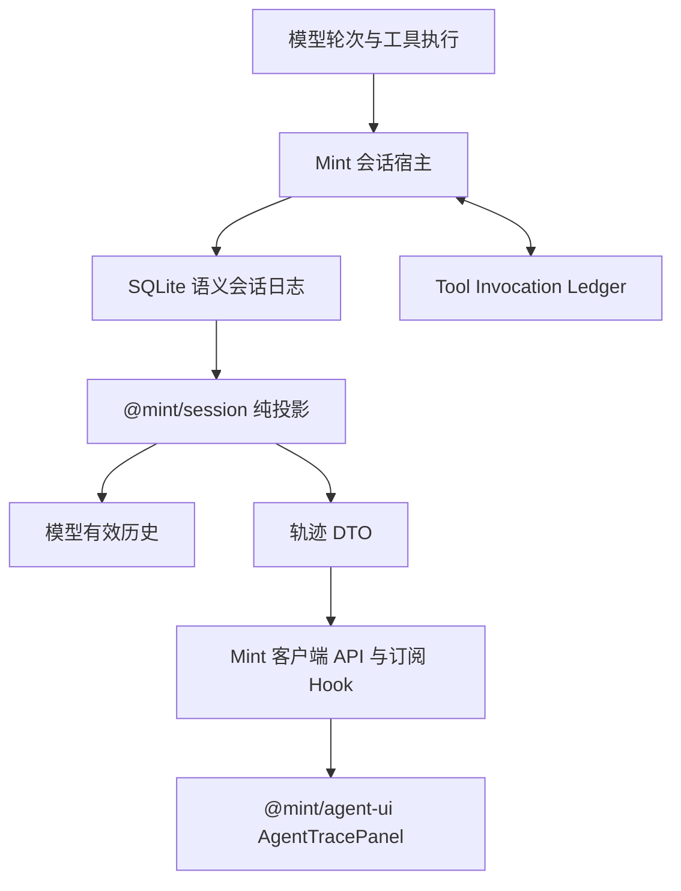

# 会话轨迹持久化与恢复：设计文档

- 变更：`2026-10-20-session-trajectory-recovery`
- 状态：第一、二期原范围已验收；TP-009 正在补充 Session 权威聊天投影和明文事件迁移。
- 主文档：product-spec.md；任务拆分：exec-plan.md。
- 新增表、接口、包和组件已实现。验收证据及未验证的生产环境边界见 `traceability.md`。

## 1. 当前依据与设计选择

当前拥有三类记录：messages 最终消息、AgentRun 最小生命周期事件、Tool Invocation Ledger 执行状态与加密参数。前端 chatRuntimeStore 的 Map 保存即时轨迹，刷新后不能重建。

已核对源码入口：

- `apps/server/application/conversations/message-service.ts`：普通发送读 getHistory；恢复动作读原消息之前历史并补未知工具对。
- `apps/server/agent-runtime/agent-run.ts` 与 agent-run-persistence.ts：只持久化部分生命周期，不保存完整结果或每轮消息。
- `apps/server/agent-runtime/react-loop-core.ts`：模型轮次、工具调度、上下文替换和输出事件。
- `apps/server/application/conversations/ai-proxy.ts`：普通 stream 的工具路径。
- `apps/client/src/features/chat/hooks/chatRuntimeStore.ts`：内存状态。
- DeepSeek 参考：`packages/core/session/src/repair.ts`、`packages/session/session-checkpoint-policy/src/index.ts`；设计借鉴已持久语义日志、执行前屏障和合成未知结果，不照搬其全部插件系统。

GitNexus 在 2026-10-20 查询；索引时间为 2026-10-18，早于当前工作区新增恢复代码。AgentRun upstream risk=CRITICAL：77 个影响节点、23 个直接节点、13 个流程、5 个模块；涉及普通对话、恢复、审批、eval。ToolExecutionService risk=LOW：22 个影响节点、3 个直接导入，主要入口是 tool-round-engine 和 bootstrap；图只能辅助定位。ChatAreaView 的旧图结果 UNKNOWN 已通过实际调用点确认其在 ChatArea 中使用。实施前必须刷新并重跑各目标影响分析，不能用以上数字当作当前完整边界。

| 方案                        | 取舍                                                                                |
| --------------------------- | ----------------------------------------------------------------------------------- |
| 扩大现有 SSE 事件持久化     | 能快速显示历史，但传输分片、运行状态和模型消息语义混杂，仍难重建正确 Tool Call 分组 |
| 仅在恢复时从 Ledger 拼消息  | 保留已有能力，但缺失早期已完成结果、上下文变化和前端历史                            |
| 追加语义会话日志 + 两个投影 | 采用；增加一个清晰的会话契约，复用现有执行 Ledger，减少模型与 UI 各维护一套历史     |

## DS-001：包边界与投影

创建 `packages/session`，名称 `@mint/session`。理由是服务端需要模型历史投影，浏览器和组件库需要同一事件标识、轨迹 DTO 与排序规则，纯逻辑具有独立复用价值。

拟定公开入口：

- `@mint/session`：SessionEvent 联合类型、事件版本校验、序列验证、repairPlan、deriveModelHistory。
- `@mint/session/trace`：TraceEntry、TraceSnapshot、时间/轮次/调用定位数据与纯轨迹投影。
- 不提供数据库、HTTP、权限、加密实现、工具执行、LLM 调用或 React Hook。包内 DTO 不允许携带密钥。
- 持久载荷解密和会话授权完成后，由宿主传入可投影的语义事件；未经授权的 UI 使用安全 TraceEntry。
- 返回值做防御性复制；不能把宿主的可变消息数组直接存入会话状态。

创建 `packages/agent-ui`，名称 `@mint/agent-ui`，定位为面向 Agent 的 React 组件库。只依赖 React peerDependencies 与 `@mint/session/trace` 的公开 DTO；首个公开组件是 AgentTracePanel。两包禁止反向导入 apps 或其他 runtime 包。react-runtime 与 tool-runtime 保持现有执行职责。



## DS-002：SQLite 存储、兼容与事件明文

新增迁移，最终编号由实施时的 migrations 列表确定：

- `conversation_session_state`：conversation_id、schema_version、last_seq、generation、history_completeness、owner_id、owner_fence、lease_expires_at、updated_at。
- `conversation_session_events`：conversation_id、event_id、seq、run_id、turn_id、round、call_id、type、created_at、elapsed_ms、schema_version、payload_json。
- 约束：UNIQUE(conversation_id, seq)、UNIQUE(conversation_id, event_id)；修复事件确定性 eventId；会话删除级联。索引至少覆盖 conversation_id + seq 和 run_id。
- 安全预览由显式字段白名单产生：类型、工具名、状态、时间、callId、来源与完整性；不可把原始命令或正文 substring 当作“安全摘要”。
- Session 语义事件以 JSON 明文保存，避免每次读取都对整条轨迹解密。迁移 36 在事务中读取旧密文、解密并验证 JSON，再写入新列；任一条失败则整次迁移回滚。迁移后读取只解析 JSON，不访问加密密钥。API 密钥、凭据和独立工具 Ledger 的加密不受此决定影响。
- 存储契约为宿主 SessionRepository：appendBatch(expectedSeq, ownerFence, events)、readThrough(highWatermark)、readAfter(cursor)、readDetail(eventId)、claimOwner、repairTail。SQLite 事务属于适配器，不放入 session 包。

启用新日志时事务性导入既有真实 messages，使用由旧 messageId 生成的稳定 eventId；保存一次性导入边界与 legacy_partial。已有 AgentRun 事实可展示为历史摘要，但不得伪造工具正文或执行结果。若仍有旧进程运行，禁止升级该会话的写入所有权。

messages 是兼容读模型。用户消息、最终回答与恢复回答通过同一宿主事务更新语义事件和 messages 投影，使用稳定 messageId 去重。模型历史统一从 Session 派生，不从 messages 再叠加同一批已导入事件。压缩历史的旧行为必须转入有效视图，不能继续独立改写消息表造成真源冲突。

### TP-009 补充决定：Session 是聊天历史唯一真源

聊天读取先校验会话并执行必要的中断修复，再从 Session 事件生成 UI 消息；不再把 `messages` 表作为聊天历史来源。`messages` 保留作兼容投影和现有记忆/A2UI 关联。最终 assistant 的 Session 事件携带稳定 `messageId`，A2UI 继续按该 ID 关联。历史事件缺少该 ID 时用内容和时间对兼容行做一次性最佳匹配，不凭空补造工具调用。

UI 投影保留 user 消息、每轮 assistant 内容/可用 reasoning，以及按 callId 配对的工具调用、结果和未知状态。提供方没有返回 reasoning 时不展示虚构思维链。会话事件仍按不可信文本处理；明文存储意味着需要依靠本机数据库权限和应用级访问控制保护静态数据，详情读取仍检查 conversationId 归属。

## DS-003：语义事件与模型消息保真

推荐事件：

- turn_started、user_message、request_context、assistant_message。
- tool_dispatch_committed、tool_result、approval_requested、approval_decided。
- context_replaced、run_terminal、turn_interrupted、recovery_result。

共同身份为 conversationId / eventId / seq / runId / turnId / round / callId，字段按事件类型必需；seq 为会话持久游标，不能直接复用当前 SSE sequence。
assistant_message 在一轮模型响应组装完成后保存一次，包含全部 Tool Calls、正文、已返回 reasoning 及适配器明确需要的消息扩展。模型协议有 opaque/signature 字段时由适配器序列化保存，不自行改写或伪造；提供方不兼容时显式降级或阻止继续，不能伪装恢复成功。Session 事件落库为明文 JSON。

request_context 记录该次请求实际使用的上下文贡献及有序消息引用，包括运行环境提醒、记忆注入、工具 schema 版本、提示词版本和模型标识。禁止记录 API key、Authorization、Cookie 等传输秘密；不要重复复制整个历史，每次只记录新增或替换的部分及引用。
模型历史投影以“语义事件 + 最近有效 context_replaced”为准；摘要替换只改变有效视图，不删除原日志。工具大输出保存实际喂给模型的最终文本；可附原始 artifact 引用，但模型重建不能依赖该引用仍可读取。
每个模型轮次的消息列表以快照引用关联已提交前缀，可用于验证恢复顺序。恢复不是恢复 KV cache、旧 system 权限或旧请求连接。

并行工具由 assistant_message 维护原模型调用分组；执行完成事件可按实际落盘次序记录，模型投影必须形成合法配对。不能沿用当前逐工具返回 assistantMsg 的方式重复插入整个 assistant Tool Calls。未知结果补齐后，任何 adapter 请求都不得有悬空调用或同 callId 多个有效结果。

## DS-004：语义检查点与执行路径

实施覆盖 ReAct、普通 stream 工具分支、审批继续、取消和重新生成。接入点在宿主执行协调层，而非仅监听 UI SSE。

1. 用户提交：获取会话写入所有权，原子追加用户消息与兼容投影。
2. 模型请求：提交前序上下文/结果事件，再发起请求。
3. 模型返回：组装完成后追加 assistant_message，再开始任一工具分派。
4. 完成 lookup、validate、authorize、policy 和 approval。拒绝或审批等待记录各自结果，不写成已执行。
5. 执行前事务：将 Session tool_dispatch_committed 和 Ledger 的 begin/参数快照写入同一个 SQLite 事务，提交成功才进入 tool body。使用宿主协调器组织事务，不让纯包依赖 Ledger。
6. 工具返回：在结果最终裁剪/工件处理完成、确定模型可见内容后，持久追加 tool_result；必须在下一次模型调用前提交。Ledger 仍独立保存工具完成事实。
7. 最终回答：提交回答及 messages 投影，再发布已持久完成节点。streaming delta 仍可提前显示，但只能标记为临时内容。
8. 持久结果写入失败：停止新模型和工具操作；外部副作用可能已成功，不回滚为失败，不自动 retry。下一次恢复依据缺失结果与 Ledger 事实核对。

数据库配置的同步持久性保证必须在进程强退测试中验证；本方案不承诺主机断电后每个字节仍完整。

## DS-005：冷恢复、活运行与修复幂等

在会话互斥入口获取 DB ownerFence。所有写入均校验最新 fencing token。采用有期限所有权：TTL 与 heartbeat 间隔配置化，TTL 必须大于多次 heartbeat 周期；活审批暂停继续维护所有权。无法确认旧持有者失活时显示恢复待定，拒绝并行执行，允许只读历史浏览。旧持有者 lease 失效后禁止新模型和工具分派；已在外部执行的工具仍按未知结果处理。

纯 repairPlan 读取有效前缀并生成计划，宿主在 expectedSeq + fence 事务内追加：

- 有 assistant 请求、无分派：只有新版本检查点路径可证明未进入执行时补 TOOL_NOT_STARTED。
- 有分派无 tool_result：补 TOOL_OUTCOME_UNKNOWN；包含 ledgerStatus、原 run/call ID、外部状态未核实提示。Ledger success 也不能补造真实结果。
- 有结果：原样保留；没有新合成结果。
- 未完成的 step/turn：追加中断边界；同一 repair eventId 重复提交视为幂等。
- 活运行或活审批：不修复、不重新执行审批；同进程正常审批继续按原流程执行。
- 进程死亡后的旧审批：作为历史展示，下一运行重新申请当前审批，禁止自动批准。

父进程退出不证明外部命令或远端操作已停止。未知结果的说明必须保留这一事实；一次文件读取也不证明后台写入已经结束。核对工具或人工确认提供证据后才能判断下一步，恢复函数自身不做通用自动补偿。合成提示是给模型的上下文，不能代替权限、策略和审批的确定性拦截。

读轨迹 API 只验证并展示前缀，不触发修复写入。缺失密文、序列断档、未知必需 schemaVersion 阻止模型重建，并以明确诊断展示可读前缀。

## DS-006：统一上下文入口与运行血缘

新增宿主服务 `prepareConversationTurn`（拟定名）：持有会话执行作用域 → 冷修复 → 派生有效历史 → 追加新输入或显式继续输入 → 应用当前上下文提供器 → 创建新 Run。

普通用户输入“可以继续吗”时，先修复旧轮、保留旧结果，再追加这条新用户消息；旧 Run 与新 Run 通过 originRunId / successorRunId / recoveryActionId 关联。显式恢复按钮调用相同入口，并追加标记来源的恢复指令，不再次追加原用户请求。

重新生成生成显式分支/有效视图边界：旧事件只读保留。无工具历史时，下一请求选择被重生成回答之前的有效前缀；原回答保留在审计轨迹并标注已被替代。存在工具历史时，不允许直接重生成原任务，返回 409 REGEN_REQUIRES_NEW_REQUEST，提示用户发送新请求；新轮保留原工具执行事实，避免剪掉历史后重做副作用。审批继续只对仍活的获批运行追加对应事件；冷审批走新运行流程。

该服务负责最终回答与恢复回答统一落库，修复目前 streamRecoveryAction 直接调模型却未统一走普通回复持久化收口的差异。保留 Ledger succeeded 禁 retry、缺参数禁直接重放等治理；将“retry”文案收敛为“继续核对”，不以按钮名暗示自动重执行。

## DS-007：轨迹 API、HTTP/IPC 与游标

API-001：GET `/conversations/:id/trajectory`，参数 afterSeq（非负整数，默认 0）、pageSize（默认 100，上限 500）、可选 throughSeq。读取前在会话租约下尝试冷修复；活动持有者时不修复。返回 generation、highWatermark、nextAfterSeq、hasMore、historyCompleteness、tailIncomplete、逐事件安全 metadata、可合并的 entries 和 runs 摘要。分页以事件 seq 为游标，固定 throughSeq 避免页间漂移。

API-002：GET `/conversations/:id/trajectory/events/:eventId`，显式展开详情。返回 `{ eventId, availability, historyCompleteness, payload?, errorCode?, message? }`；跨会话不暴露目标存在性，JSON 损坏时以 unavailable 和稳定诊断返回，不使用空文本冒充有效结果。

API-003：GET `/conversations/:id/trajectory/events` SSE，带 afterSeq / Last-Event-ID。服务按持久游标读取并补发提交后的元数据；通知不含正文。Electron 直接调用同一个 stream descriptor 的服务函数，经 IPC 发送增量并支持取消，不启动隐藏 HTTP。快照之后、订阅建立之前提交的事件仍会由游标补发。

三者通过 endpoints descriptor、前端 services/api 导出、Electron handler/preload/类型/manifest 注册。使用已有会话访问边界，并在详情入口再次校验 event.conversationId。输入损坏 400、有效持有者冲突 409、载荷 JSON 损坏时返回显式错误。将 session schema 版本与传输 DTO 版本分开。
客户端按 conversationId + generation 缓存；序号相同按 eventId 去重，发现 gap 回补，切换会话取消旧请求并丢弃过期响应。初始持久序号与现有 SSE sequence 不可混用。

传输契约补充：

- TraceSnapshot.historyCompleteness 为 complete 或 legacy_partial；tailIncomplete 为 boolean，标明当前末尾是否曾丢失未提交的流式片段。complete 仅指启用日志后的已提交语义边界齐全。
- events 是逐持久事件的安全元数据，而非聚合后的 UI 行；每个 seq 均可到达，避免工具结果合并到旧行后出现游标缺口。元数据包含 eventId、seq、runId、turnId、round、callId、type、createdAt、durationMs、status、label、detailAvailable、synthetic 和明确的关联 ID，字段按事件类型可选。
- runs 摘要包含 runId、status、originRunId（可空）、turnId、startedAt、endedAt（可空）。时间缺失不能产生虚假耗时。
- useConversationTrajectory 累积连续元数据，再通过 @mint/session/trace 投影成 entries。工具分派和结果可合并为一个稳定 callId 行，sourceEventIds 保留其来源；迟到结果更新同一行，不追加第二条相同调用。
- 详情返回 eventId、availability（available / missing / unavailable）和 payload；payload 按事件类型区分 message、argumentsJson、modelResult 等。不可读时返回诊断和完整性标志，禁止用占位正文假装成功。
- 详情在同一会话内显式读取；搜索只查安全 label、工具名与状态。真实正文留在解密详情，浏览器默认缓存只留授权范围且在切换/删除会话时清除。

## DS-008：@mint/agent-ui 与宿主适配

拟定结构：

```text
packages/session/src/
  contracts.ts
  model-projection.ts
  trace-projection.ts
  repair.ts
  index.ts
packages/agent-ui/src/
  components/agent-trace-panel/
    AgentTracePanel.tsx
    TraceToolbar.tsx
    TraceOverview.tsx
    TraceEventList.tsx
    TraceEventDetail.tsx
  styles/tokens.css
  styles/agent-trace-panel.css
  index.ts
apps/client/src/features/chat/
  components/ConversationTraceView.tsx
  hooks/useConversationTrajectory.ts
```

AgentTracePanel 的公开 props 包含 entries/runs、loading/error/completeness、viewMode、query、types、selectedEventId、detail 状态及 onSelect/onQueryChange/onTypesChange/onViewModeChange/onLoadMore/onRetry/onOpenDetail 等受控回调。具体 TypeScript 由 TP-007 确定，但宿主数据/权限职责不得移入组件。
文本渲染默认安全纯文本，复杂 Markdown 由可选 renderContent 接口交给宿主；不执行模型返回 HTML、命令或路径。组件只请求“展开详情”，网络由宿主处理。
CSS 只使用 `.mint-agent-trace-*` 与 `--mint-agent-ui-*` tokens；Mint 包装层映射现有 design tokens。独立最小 React 宿主提供同样 props 即可使用。公开导出 AgentTracePanel、props 类型、显式样式入口；不一次性导出所有内部行组件。
React / ReactDOM 使用项目兼容的 peerDependencies；构建不打包另一份 React。客户端与 Electron 构建先生成 session 和 agent-ui，确保 exports 和资源路径一致。

## DS-009：DeepSeek 参考交互与布局

用户截图已保存为 [DeepSeek 对话参考](references/deepseek-chat.png) 和 [DeepSeek 轨迹参考](references/deepseek-trajectory.png)，供实现与视觉评审使用。仅参考产品布局，不宣称像素级复刻或复用品牌。

```text
会话标题
[ 对话 ] [ 轨迹 ]
---------------------------------------------------
[ 时长 ] [ 轮次 ] [ 调用 ]  [类型过滤]    [搜索]
输入   ▬▬▬  ▬▬▬             ▬▬▬
模型          ▬▬▬   ▬▬▬          ▬▬▬
工具             ▬▬▬   红色未知节点
---------------------------------------------------
第 1 轮
  上下文   运行环境提醒       > 展开
  助手     本轮模型输出       > 展开
  工具     bash 参数摘要 → 结果状态  > 展开详情
  工具     write_file → 结果未知
  中断     本轮意外停止
第 2 轮 · 继续自原运行
  用户     可以继续吗
  工具     read → 已完成
```

页签由 ChatHeader/聊天容器管理；默认进入对话，轨迹面板占用聊天正文区域。不是悬浮模态框。只读查看不会停止活运行；切回对话时保留滚动位置与未发送草稿，不因条件卸载 InputBox 丢失本地文本。

- 三条泳道为输入、模型、工具；输入/上下文绿、模型紫、工具橙、未知/错误红，仍跟随主题 tokens，状态附文字与图标。
- “时长”按已知时间比例，“轮次”按轮次分段，“调用”按模型/工具调用索引展示；缺少完成时间的节点显示“中断 / 时长未知”，不虚构结束时间。
- 点总览块选中并滚动到对应事件；类型过滤隐藏无关行；搜索在已加载预览中高亮且展示匹配数量，不搜索隐藏的解密正文。
- 行预览截断，展开后读取独立详情；参数为格式化 JSON 或标注无效 JSON 的原文，结果为实际模型可见文本。TOOL_OUTCOME_UNKNOWN 显示“结果未知”，不能等同“工具执行失败”。
- 有 legacy_partial 或 partial tail 时显示常驻说明；空会话显示“暂无轨迹”；加载失败有重试且不展示其他会话缓存。
- 使用 tablist/tab/tabpanel、toolbar、searchbox 和 button 语义；键盘操作和可见焦点；移动窄屏工具条换行、长参数局部滚动、面板不撑出视口。
- 轨迹页提供“返回对话继续”入口；恢复卡片是中断事实提示，继续新对话不调用旧 retry API。活运行期间发送规则保持现有单运行保护。
- 新旧运行关系在列表分段展示；既有顶部简版 DecisionTrace 可保留为当前运行概览，完整记录只在新面板中维护一个投影来源。

## DS-010：迁移、发布、边界与验证

增加两个 workspaces、构建顺序和 Electron bundle 白名单；更新相关 TS 引用与依赖锁文件，但不趁机改其他包。新增 API 实施时按 add-endpoint 技能走完整注册。

分期启用：先把完整语义写入与模型历史投影在同一新模式下接入，再开放统一恢复与轨迹页签。任一会话激活新日志后不得因关开关回到旧 messages 重建路径；可关闭 UI 入口，但不能绕过日志继续写。老会话仅一次性导入，无法迁移时旧记录只读并明确报错。迁移前按现有规则备份 DB 与密钥；此方案不包含自动降级 DB。

验证要覆盖真实 SQLite 故障、独立进程 SIGKILL、重新启动后的普通发送、两个持有者 fencing、正常审批/取消、HTTP/SSE/IPC 游标，以及独立组件宿主与 Web/Electron 产物加载。浏览器 mock 场景证明控件交互，不代替真实崩溃证据。

## 验收证据矩阵

| AC     | 设计                     | 执行任务                 | 状态   |
| ------ | ------------------------ | ------------------------ | ------ |
| AC-001 | DS-001                   | TP-001                   | 待验证 |
| AC-002 | DS-003                   | TP-003                   | 待验证 |
| AC-003 | DS-002 / DS-004          | TP-002 / TP-003          | 待验证 |
| AC-004 | DS-004                   | TP-003                   | 待验证 |
| AC-005 | DS-005                   | TP-004                   | 待验证 |
| AC-006 | DS-005                   | TP-004                   | 待验证 |
| AC-007 | DS-006                   | TP-005                   | 待验证 |
| AC-008 | DS-003 / DS-006          | TP-003 / TP-005          | 待验证 |
| AC-009 | DS-002 / DS-010          | TP-002                   | 待验证 |
| AC-010 | DS-002 / DS-007 / DS-008 | TP-002 / TP-006 / TP-007 | 待验证 |
| AC-011 | DS-007                   | TP-006                   | 待验证 |
| AC-012 | DS-001 / DS-008          | TP-007 / TP-008          | 待验证 |
| AC-013 | DS-008 / DS-009          | TP-007                   | 待验证 |
| AC-014 | DS-007 / DS-009          | TP-006 / TP-007          | 待验证 |
| AC-015 | DS-005 / DS-009          | TP-004 / TP-008          | 待验证 |
| AC-016 | DS-006 / DS-009          | TP-005 / TP-008          | 待验证 |
| AC-017 | DS-002 / DS-005 / DS-010 | TP-002 / TP-008          | 待验证 |
| AC-018 | DS-004 / DS-006 / DS-010 | TP-003 / TP-005 / TP-008 | 待验证 |

## 风险、未验证项与后续

高风险集中于同库事务组织、审批活运行识别、当前 history 压缩方式、模型 reasoning 兼容和前端隐私。所有风险由对应 AC 探针约束，不能用静态类型检查替代。
第三期才考虑逐 token/节流尾部快照和新的大工件治理；本期必须先让模型可见结果在现有存储中可持久重建。
所有技术名称为方案契约，具体文件可在实施中调整，但须记录偏差；本轮没有实现或行为通过证据。
